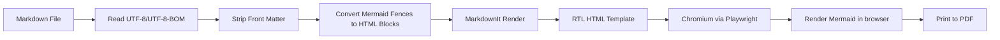
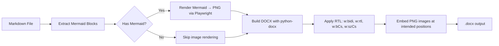
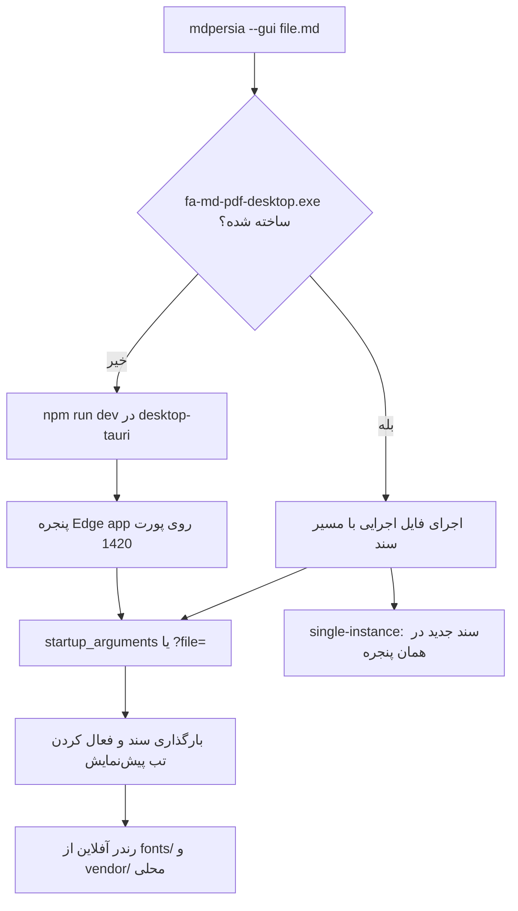

# معماری پروژه

## هدف

تبدیل مستندات Markdown فارسی/راست‌به‌چپ، شامل نمودارهای Mermaid، به **PDF** یا **DOCX** با ابزارهای CLI و GUI قابل استفاده در ویندوز و CI، با تمرکز بر **اجرای کاملاً آفلاین**.

## جریان تبدیل PDF

## جریان تبدیل DOCX

## جریان GUI

رابط گرافیکی، اپلیکیشن دسکتاپ Tauri در `desktop-tauri/` است (نه tkinter). هستهٔ Python هیچ رابطی نمی‌سازد؛ فقط یا فایل اجرایی ساخته‌شده را صدا می‌زند یا سرور توسعه را بالا می‌آورد.

در حالت توسعه، پلی Python در `vite.config.ts` درخواست‌های رابط (پیش‌نمایش، پیمایش پوشه، دیالوگ‌های ویندوز، تبدیل) به `fa_md_pdf` وصل می‌کند.

## اجزای اصلی

| فایل | مسئولیت |
|---|---|
| `cli.py` | پارس کردن آرگومان‌های خط فرمان، dispatch به PDF/DOCX/wrap-rtl/GUI و سوئیچ‌های ثبت پسوند |
| `associations.py` | ثبت/لغو/اعتبارسنجی «باز کردن با MdPersia» در رجیستری کاربر (HKCU) |
| `converter.py` | کشف فایل‌ها، ساخت jobها، اجرای Playwright (PDF) یا python-docx (DOCX) |
| `html_builder.py` | تبدیل Markdown به HTML راست‌به‌چپ و تزریق CSS/Mermaid |
| `docx_builder.py` | تولید سند Word با تنظیمات کامل RTL و embed تصاویر |
| `mermaid_renderer.py` | رندر دیاگرام‌های Mermaid به PNG (برای DOCX) |
| `rtl_wrapper.py` | بسته‌بندی بلوک‌های Persian با `
` در Markdown |
| `defaults.py` | تشخیص project root و دارایی‌های آفلاین (`browsers/`, `vendor/`, `fonts/`) |
| `assets/default.css` | استایل پایه برای فارسی، RTL، جدول‌ها، code blockها و چاپ |
| `desktop-tauri/` | رابط دسکتاپ: React + Tauri، صف، اینسپکتور، پیش‌نمایش و کنسول |

## نقطه‌های ورود

| ورودی | مقصد |
|---|---|
| `mdpersia` / `fa-md-pdf` | `cli.main()` |
| `mdpersia --gui` | `cli.main()` → اپلیکیشن دسکتاپ `desktop-tauri` |
| `fa-md-pdf.exe` | `entry_point.py` → `cli.main()` (PyInstaller) |

## تصمیم‌های طراحی

### چرا HTML → PDF؟

برای فارسی و Mermaid، مسیر HTML به PDF در عمل ساده‌تر و قابل کنترل‌تر از LaTeX است. Chromium از CSS، فونت‌های سیستم، SVG و جهت راست‌به‌چپ پشتیبانی خوبی دارد.

### چرا Playwright؟

Playwright کنترل مستقیم Chromium را فراهم می‌کند و می‌تواند صفحه HTML را با CSS print به PDF تبدیل کند. همچنین برای رندر Mermaid به PNG (در مسیر DOCX) قابل استفاده است.

### چرا Mermaid داخل مرورگر رندر می‌شود؟

این روش نیاز به نصب Node.js یا Mermaid CLI ندارد. در مسیر PDF، فایل Markdown به HTML تبدیل می‌شود و Mermaid.js در همان صفحه نمودارها را به SVG تبدیل می‌کند. در مسیر DOCX، Mermaid در یک صفحه موقت رندر شده و خروجی به‌صورت PNG screenshot گرفته می‌شود.

### چرا python-docx برای DOCX؟

`python-docx` کتابخانه‌ای خالص پایتون است (بدون نیاز به Word یا COM)، و امکان دسترسی مستقیم به XML سند Word برای تنظیم بیت‌های RTL (`w:bidi`، `w:rtl`، `w:bCs`، `w:szCs`) را فراهم می‌کند که برای رندر صحیح متن فارسی ضروری است.

### معماری GUI (Tauri + پل Vite)

رابط گرافیکی از دو مسیر مستقل و هماهنگ پشتیبانی می‌کند:
1. **حالت توسعه (Dev Mode):** هسته‌ی پایتون سرور توسعه Vite را بر روی پورت `1420` اجرا می‌کند. عملیات بومی سیستم (مانند دیالوگ‌های انتخاب فایل و پوشه، پیمایش مسیرها، پیش‌نمایش HTML زنده و اجرای تبدیل) از طریق Middleware اختصاصی Vite در `desktop-tauri/vite.config.ts` انجام می‌شود.
2. **حالت بسته‌بندی‌شده (Packaged App):** با استفاده از Tauri v2، دستورات Native به لایه‌ی Rust (`lib.rs`) و پلاگین‌های سیستمی (`fs`، `dialog`، `shell`، `single-instance`) واگذار می‌شوند.
3. لایه‌ی انتزاعی `tauriBridge.ts` در فرانت‌اند React، تفاوت بین این دو محیط را کاملاً مخفی کرده و واسط یکپارچه‌ای برای برنامه فراهم می‌کند.

### مدیریت تک‌نمونه (Single Instance)

برای جلوگیری از باز شدن چند پنجره یا اشغال مجدد پورت ۱۴۲۰ در هر بار دابل‌کلیک روی یک سند `.md`، سیستم تک‌نمونه با دو لایه محافظت عمل می‌کند:
- بررسی پورت ۱۴۲۰ در لانچر پایتون و هدایت سند جدید به همان سرور
- استفاده از `BroadcastChannel` در مرورگر (`singleInstance.ts`) و پلاگین `single-instance` در محیط Tauri برای تحویل آنی سند به تب Preview پنجره‌ی موجود.

### پشتیبانی از اجرای frozen (PyInstaller)

`defaults.find_project_root()` وقتی `sys.frozen` فعال باشد (یعنی برنامه به‌صورت exe اجرا می‌شود)، فولدر کنار فایل exe را هم در جستجوی project root در نظر می‌گیرد. این یعنی کاربر می‌تواند فولدرهای `browsers/`، `vendor/` و `fonts/` را کنار exe قرار دهد و تبدیل آفلاین انجام شود.

## محدودیت‌ها

- اگر از CDN Mermaid استفاده شود، برای تبدیل به اینترنت نیاز است.
- برای حالت کاملاً آفلاین باید فایل `mermaid.min.js` محلی داده شود.
- کیفیت PDF به فونت‌های نصب‌شده روی سیستم بستگی دارد.
- DOCX از فونت سیستمی استفاده می‌کند (نه فایل embed شده)؛ Vazirmatn یا فونت انتخابی باید روی سیستم بازکننده فایل نصب باشد.
- برخی قابلیت‌های بسیار خاص Markdown ممکن است نیاز به plugin جداگانه داشته باشند.

