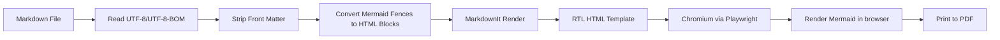
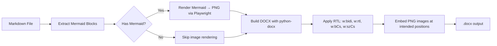
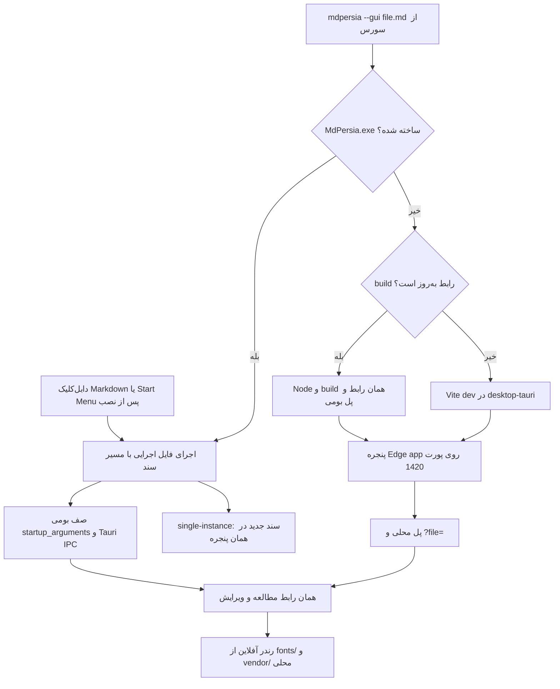

# معماری پروژه

## هدف

تبدیل مستندات Markdown فارسی/راست‌به‌چپ، شامل نمودارهای Mermaid، به **PDF** یا **DOCX** با ابزارهای CLI و GUI قابل استفاده در ویندوز و CI، با تمرکز بر **اجرای کاملاً آفلاین**.

## جریان تبدیل PDF

## جریان تبدیل DOCX

## جریان GUI

رابط گرافیکی در `desktop-tauri/` مشترک است. بستهٔ نصب‌شده، `MdPersia.exe` مبتنی بر Tauri و WebView2 را اجرا می‌کند؛ `commands.rs` پیش‌نمایش، خواندن و ذخیره را به worker مشترک stdio در `reader/mdpersia-reader.exe` می‌فرستد. این worker همان `preview_worker` و سازندهٔ HTML پروژه را استفاده می‌کند. PDF و Word در موتور اختیاری `mdpersia-engine.exe` و پردازش مستقل اجرا می‌شوند. Windows Job Object فرزندان موتور، از جمله مرورگر تبدیل، را هنگام توقف یا خروج می‌بندد. این مسیر سرور محلی یا Python/Node سیستمی اجرا نمی‌کند.

`conversion_runtime.rs` بستهٔ اختیاری را فقط به درخواست کاربر دریافت می‌کند. catalog شامل نسخه، حجم، URL و SHA-256 داخل فایل بومی کامپایل می‌شود. بسته پس از تطبیق hash، استخراج محدود و بررسی اجرای موتور، به‌صورت اتمیک در `app_local_data_dir/conversion-runtime/<sha256>` قرار می‌گیرد. در شروع برنامه فقط وضعیت محلی بررسی می‌شود. لغو، خطای شبکه، بستهٔ خراب و ورود ZIP مسیرهای مجزا دارند؛ فایل‌های موقت حذف می‌شوند و قابلیت مطالعه به این بسته وابسته نیست.

اجرای سورس از `mdpersia --gui` ابتدا فایل بومی ساخته‌شده را جستجو می‌کند. در نبود آن، همان رابط از پل محلی Node استفاده می‌کند: اگر build به‌روز باشد، `dist/` سرو می‌شود؛ در غیر این صورت Vite اجرا می‌شود.

پل مشترک در `desktopBridge.ts` در حالت توسعه و اجرای build درخواست‌های همان رابط (پیش‌نمایش، پیمایش پوشه، دیالوگ‌های ویندوز، تبدیل) را به `fa_md_pdf` وصل می‌کند.

در بستهٔ بومی، `tauriBridge.ts` این درخواست‌ها را با IPC می‌فرستد. تحویل فایل تک‌نمونه در صف Rust نگه‌داری می‌شود و پس از ثبت listener تخلیه می‌شود تا فایل میان راه‌اندازی و آماده‌شدن رابط گم نشود. فایل‌های بعدی به صف فعلی افزوده می‌شوند. جزئیات ساخت و پذیرش بسته در [WINDOWS-RELEASE.md](WINDOWS-RELEASE.md) آمده است.

## اجزای اصلی

| فایل | مسئولیت |
|---|---|
| `cli.py` | پارس کردن آرگومان‌های خط فرمان، dispatch به PDF/DOCX/wrap-rtl/GUI و سوئیچ‌های ثبت پسوند |
| `associations.py` | ثبت/لغو/اعتبارسنجی «باز کردن با MdPersia» در رجیستری کاربر (HKCU) |
| `converter.py` | کشف فایل‌ها، ساخت jobها، اجرای Playwright (PDF) یا python-docx (DOCX) |
| `html_builder.py` | تبدیل Markdown به HTML راست‌به‌چپ و تزریق CSS/Mermaid |
| `docx_builder.py` | تولید سند Word با تنظیمات کامل RTL و embed تصاویر |
| `mermaid_renderer.py` | رندر دیاگرام‌های Mermaid به PNG (برای DOCX) |
| `rtl_wrapper.py` | بسته‌بندی بلوک‌های Persian با `
` در Markdown |
| `defaults.py` | تشخیص project root و دارایی‌های آفلاین (`browsers/`, `vendor/`, `fonts/`) |
| `assets/default.css` | استایل پایه برای فارسی، RTL، جدول‌ها، code blockها و چاپ |
| `desktop-tauri/` | رابط دسکتاپ: React + Tauri، صف، اینسپکتور، پیش‌نمایش و کنسول |

## نقطه‌های ورود

| ورودی | مقصد |
|---|---|
| `mdpersia` / `fa-md-pdf` | `cli.main()` |
| `mdpersia --gui` | `cli.main()` → اپلیکیشن دسکتاپ `desktop-tauri` |
| `MdPersia.exe` | Tauri → `commands.rs` → موتور داخلی |
| `mdpersia-reader.exe` | `scripts/desktop-reader-entry.py` → `desktop_reader.main()` → همان preview worker |
| `mdpersia-engine.exe` | `scripts/desktop-engine-entry.py` → `desktop_engine.main()` → همان CLI/worker |

## تصمیم‌های طراحی

### چرا HTML → PDF؟

برای فارسی و Mermaid، مسیر HTML به PDF در عمل ساده‌تر و قابل کنترل‌تر از LaTeX است. Chromium از CSS، فونت‌های سیستم، SVG و جهت راست‌به‌چپ پشتیبانی خوبی دارد.

### چرا Playwright؟

Playwright کنترل مستقیم Chromium را فراهم می‌کند و می‌تواند صفحه HTML را با CSS print به PDF تبدیل کند. همچنین برای رندر Mermaid به PNG (در مسیر DOCX) قابل استفاده است.

### چرا Mermaid داخل مرورگر رندر می‌شود؟

این روش نیاز به نصب Node.js یا Mermaid CLI ندارد. در مسیر PDF، فایل Markdown به HTML تبدیل می‌شود و Mermaid.js در همان صفحه نمودارها را به SVG تبدیل می‌کند. در مسیر DOCX، Mermaid در یک صفحه موقت رندر شده و خروجی به‌صورت PNG screenshot گرفته می‌شود.

### چرا python-docx برای DOCX؟

`python-docx` کتابخانه‌ای خالص پایتون است (بدون نیاز به Word یا COM)، و امکان دسترسی مستقیم به XML سند Word برای تنظیم بیت‌های RTL (`w:bidi`، `w:rtl`، `w:bCs`، `w:szCs`) را فراهم می‌کند که برای رندر صحیح متن فارسی ضروری است.

### معماری GUI (Tauri + پل Vite)

رابط گرافیکی از دو مسیر مستقل و هماهنگ پشتیبانی می‌کند:
1. **اجرای محلی:** لانچر Python روی پورت `1420` همان رابط React را اجرا می‌کند. پس از `npm run build`، تا زمانی که سورس تغییر نکرده، از `dist/desktop-server.mjs` و فایل‌های آماده استفاده می‌شود؛ ابزارهای Vite، React و Tailwind در مسیر راه‌اندازی سرور تولیدی بارگذاری نمی‌شوند؛ سورس جدیدتر به Vite dev هدایت می‌شود. Middleware مشترک در `desktop-tauri/desktopBridge.ts` تمام عملیات بومی را در هر دو حالت فراهم می‌کند. سرور تولیدی چند ثانیه پس از بسته‌شدن آخرین پنجره و پایان تبدیل‌های درحال‌اجرا متوقف می‌شود.
2. **حالت بسته‌بندی‌شده (Packaged App):** با استفاده از Tauri v2، دستورات Native به لایه‌ی Rust (`lib.rs`) و پلاگین‌های سیستمی (`fs`، `dialog`، `shell`، `single-instance`) واگذار می‌شوند.
3. لایه‌ی انتزاعی `tauriBridge.ts` در فرانت‌اند React، تفاوت بین این دو محیط را کاملاً مخفی کرده و واسط یکپارچه‌ای برای برنامه فراهم می‌کند.

### مدیریت تک‌نمونه (Single Instance)

برای جلوگیری از باز شدن چند پنجره یا اشغال مجدد پورت ۱۴۲۰ در هر بار دابل‌کلیک روی یک سند `.md`، سیستم تک‌نمونه با دو لایه محافظت عمل می‌کند:
- قفل راه‌اندازی کاربر در ویندوز، برای جلوگیری از رقابت چند دابل‌کلیک همزمان در شروع سرد
- بررسی هویت MdPersia با `/api/health`؛ ارسال مسیر فایل به `/api/open-file` و تحویل آن به پنجرهٔ باز از طریق SSE، بدون ساخت پنجره یا سرور اضافه
- استفاده از `BroadcastChannel` در مرورگر (`singleInstance.ts`) و پلاگین `single-instance` در محیط Tauri برای تحویل آنی سند به تب Preview پنجره‌ی موجود.

پیش‌نمایش‌های پل محلی بر اساس مسیر، زمان تغییر و اندازهٔ فایل cache می‌شوند؛ cache حداکثر ۸ سند و ۸ مگابایت HTML نگه می‌دارد و درخواست‌های همزمان یک فایل را ادغام می‌کند. یک پردازش `preview_worker.py` همان `html_builder` را بین درخواست‌ها آماده نگه می‌دارد و با خروج سرور متوقف می‌شود. تغییر تم و زوم در همان iframe اعمال می‌شود. بازکردن مجدد فایل یا دکمهٔ بازسازی، تغییرات جدید سند و متن خام را دوباره می‌خواند.

### قرارداد صف و مطالعه

هویت سند، مسیر کامل نرمال‌شده است؛ نام فایل یا شناسهٔ ثابت `open-0` هویت سند نیست. همهٔ مسیرهای افزودن سند به `mergeQueueItems` می‌رسند؛ بازکردن مجدد، ردیف موجود را انتخاب می‌کند و وضعیت تبدیل آن را نگه می‌دارد. سند فعال مستقل از انتخاب چندتایی است. حذف سند فعال، همسایه را نمایش می‌دهد؛ پاک‌کردن صف، پاسخ‌های درحال‌انتظار را بی‌اثر می‌کند. هیچ فایل پیش‌فرضی از محیط راه‌اندازی یا مستندات مخزن وارد صف نمی‌شود.

افزودن پوشه فایل‌های قبلی را حفظ می‌کند. گزینهٔ زیرپوشه‌ها روی افزودن‌های بعدی اثر دارد. پیش‌نمایش هنگام جابه‌جایی به کنسول یا متن خام زنده می‌ماند و محل مطالعهٔ اخیر هر سند حفظ می‌شود. لینک محلی Markdown به همین صف تحویل داده می‌شود؛ تصاویر نسبی از مسیر سند حل می‌شوند. نتیجهٔ تبدیل با شناسهٔ سند اعمال می‌شود تا فایل‌های هم‌نام قاطی نشوند. قطع SSE بدون رویداد خروج، موفقیت محسوب نمی‌شود. لغو تبدیل وب با شناسهٔ job همان پردازش متعلق به برنامه را متوقف می‌کند.

اعتبارسنجی قابل تکرار: `scripts/verify-desktop.py --start` برای گردش کار و `scripts/verify-windows-launch.py` برای راه‌انداز واقعی `pythonw` با پروفایل موقت مرورگر. هر دو از همان رابط و API پروژه استفاده می‌کنند.

### ویرایش اسناد در همان پیش‌نمایش

ویرایشگر CodeMirror به‌صورت lazy در `MarkdownEditor.tsx` بارگذاری می‌شود. متن Markdown مبنای ویرایش است؛ HTML پیش‌نمایش به Markdown برگردانده نمی‌شود. پیش‌نمایش پیش‌نویس با تأخیر کوتاه و لغو نتیجه‌های قدیمی از همان `html_builder` تولید می‌شود و تا زمان ذخیره روی فایل نوشته نمی‌شود. خاموش‌کردن پیش‌نمایش زنده، درخواست‌های رندر هنگام تایپ را متوقف می‌کند.

`useDocumentEditor` پیش‌نویس و وضعیت ذخیرهٔ هر مسیر را مستقل نگه می‌دارد. حذف/پاکسازی و شروع تبدیل از تغییرات ذخیره‌نشده محافظت می‌کنند؛ تبدیل تنها پس از ذخیرهٔ تغییرات انجام می‌شود. نسخهٔ بازیابی در IndexedDB ذخیره می‌شود، اما سندی را خودکار به صف برنمی‌گرداند. هنگام بازکردن ویرایشگر همان فایل، بازیابی عرضه می‌شود. این نسخه جایگزین ذخیرهٔ صریح فایل نیست؛ بسته‌شدن پیش از تکمیل ثبت بازیابی می‌تواند آخرین تغییرات را از دسترس خارج کند.

`document_io.py` قرارداد مشترک خواندن/نوشتن در هر دو runtime است: نسخهٔ SHA-256، UTF-8/BOM/Windows-1256، پایان‌خط اصلی، فایل موقت هم‌پوشه، flush/fsync و بررسی دوبارهٔ نسخه پیش از جایگزینی. ذخیره با نام دیگر نسخهٔ UTF-8 می‌سازد و جایگزینی فایل موجود تأیید می‌خواهد. قفل بین پردازش‌های MdPersia از موفقیت هم‌زمان دو ذخیره از یک نسخه جلوگیری می‌کند. برنامهٔ بیرونی که این قفل را رعایت نمی‌کند همچنان ممکن است در فاصلهٔ بسیار کوتاه پس از آخرین بررسی تغییر ایجاد کند؛ این قرارداد، قفل سراسری روی همهٔ ویرایشگرهای سیستم نیست.

پیش‌نمایش UI فقط اسکریپت Mermaid تولیدشدهٔ موتور را با nonce اجرا می‌کند. اسکریپت‌ها و event handlerهای خام سند با CSP مسدود می‌شوند تا محتوای Markdown به عملیات فایل در پل محلی دسترسی اجرایی نداشته باشد. این محدودیت مختص پیش‌نمایش است و متن اصلی فایل را دستکاری نمی‌کند. `scripts/verify-editor.py` پیش‌نمایش، فایل واقعی، تداخل بیرونی، بازیابی، Undo/Redo و حفظ پیش‌نویس‌ها را بررسی می‌کند.

نشانگر و انتخاب اصلی متن را خود مرورگر رسم می‌کند تا شکل‌دهی حروف و جای کرسر از یک چیدمان استفاده کنند. جهت هر خط با `dir="auto"` و ایزولاسیون همان خط تعیین می‌شود؛ تکمیل بارگذاری فونت نیز اندازه‌گیری ویرایشگر را تازه می‌کند. تولتیپ‌های مشترک پیش از نمایش اندازه‌گیری می‌شوند، داخل محدودهٔ پنجره قرار می‌گیرند و انیمیشن فقط شفافیتشان را تغییر می‌دهد. `scripts/verify-editor-geometry.py` محل کلیک، انتخاب بومی، درج و حذف واقعی، حفظ انتخاب هنگام قالب‌بندی و ثبات تولتیپ را روی build برنامه بررسی می‌کند؛ گزینهٔ `--source` فقط یک کپی آزمایشی از سند ورودی می‌سازد و فایل اصلی را نمی‌نویسد.

### ذخیرهٔ تنظیمات

چرخ‌دندهٔ کنار تغییر تم و میان‌بر `Ctrl+,` پنجرهٔ تنظیمات را باز می‌کنند. `SettingsDialog` هنگام بازشدن بارگذاری می‌شود؛ تم روشن/تاریک/سیستم، بزرگ‌نمایی، فاصلهٔ خطوط، عرض مطالعه، شکستن کد، حفظ محل مطالعه و رفتار نمایش فایل تازه یا کنسول در دسترس‌اند. تغییرات مطالعه در همان iframe اعمال می‌شوند و قالب چاپ PDF/Word را تغییر نمی‌دهند.

`appSettings.ts` تنظیمات را با نسخهٔ مشخص در `mdpersia.preferences.v1` نگه می‌دارد. مقادیر ذخیره‌شده اعتبارسنجی می‌شوند و خرابی یا مسدودبودن storage مانع خواندن سند نمی‌شود. ذخیرهٔ گزینه‌های تبدیل قابل خاموش‌کردن است؛ Watch همیشه در شروع خاموش است. صف و محتوای اسناد در این تنظیمات ذخیره نمی‌شوند. بازنشانی تنظیمات یا عرض پنل‌ها نیز اسناد صف را حذف نمی‌کند.

پنجرهٔ تنظیمات با `<dialog>` بومی، محدودکردن فوکوس، Escape و بازگرداندن فوکوس به کنترل قبلی کار می‌کند. تأیید پاک‌کردن صف اختیاری است. `scripts/verify-settings.py` رفتار واقعی کنترل‌ها، ذخیره و بازخوانی، تم سیستم، تبدیل، کیبورد و اندازه‌های مختلف پنجره را روی build همین رابط بررسی می‌کند.

### گزارش فعالیت و وضعیت پایش

کنسول رویدادها را با زمان، سطح پیام و هویت فایل نمایش می‌دهد؛ فرمان اجرا در جزئیات بازشدنی باقی می‌ماند. جستجو و فیلتر روی متن و مسیر فایل اعمال می‌شوند و کپی یا فایل متنی گزارش، فقط موارد نمایش‌داده‌شده را در بر می‌گیرد. اسکرول دستی، دنبال‌کردن خودکار رویدادها را متوقف می‌کند؛ جابه‌جایی بین پیش‌نمایش و کنسول نیز جستجو و فیلتر را حفظ می‌کند. آخرین ۱۰۰۰ رویداد در حافظه نگه‌داری می‌شوند.

حالت `--watch` پس از تبدیل، عمداً پردازش را باز نگه می‌دارد. وضعیت «در انتظار تغییر فایل» از تبدیل فعال جداست و دکمهٔ توقف پایش در گزارش قرار دارد. پل، نشانگرهای صریح فاز موتور را با حفظ تکه‌های ناقص stdout دنبال می‌کند؛ ورود به پایش به معنی خروج موفق پردازش نیست. پس از تبدیل مجدد، نتیجهٔ واقعی هر کار چاپ می‌شود و موتور به انتظار برمی‌گردد. `scripts/verify-console.py` گزارش و خروجی DOCX واقعی، فیلتر و export، اسکرول هنگام تبدیل مجدد و توقف پردازش پایش را بررسی می‌کند.

### پشتیبانی از اجرای frozen (PyInstaller)

بستهٔ دسکتاپ از PyInstaller در حالت directory استفاده می‌کند تا موتور هنگام هر بازکردن فایل از یک آرشیو موقت استخراج نشود. نصب اصلی شامل `reader/`، `assets/fonts/`، `assets/vendor/` و catalog است؛ Playwright، Node خصوصی آن و Chromium فقط در بستهٔ اختیاری قرار می‌گیرند. `desktop_engine.py` مسیر منابع را اعتبارسنجی و پیشوند ویژهٔ مسیرهای ویندوز را پیش از ساخت URL مرورگر عادی می‌کند. ارتباط stdio صریحاً UTF-8 است. نسخهٔ release در نبود موتور داخلی به Python سیستمی fallback نمی‌کند.

در اجرای سورس و CLI مستقل، `defaults.find_project_root()` همچنان محل دارایی‌های آفلاین کاربر را پیدا می‌کند. این کشف مسیر با چیدمان ثابت نصب دسکتاپ تفاوت دارد.

## محدودیت‌ها

- اگر از CDN Mermaid استفاده شود، برای تبدیل به اینترنت نیاز است.
- در اجرای CLI از سورس، برای حالت کاملاً آفلاین باید `mermaid.min.js` محلی داده شود؛ بستهٔ دسکتاپ آن را همراه دارد.
- بستهٔ دسکتاپ فونت Vazirmatn را برای PDF همراه دارد؛ استفاده از فونت سفارشی به فایل یا فونت موجود آن نیاز دارد.
- DOCX از فونت سیستمی استفاده می‌کند (نه فایل embed شده)؛ Vazirmatn یا فونت انتخابی باید روی سیستم بازکننده فایل نصب باشد.
- برخی قابلیت‌های بسیار خاص Markdown ممکن است نیاز به plugin جداگانه داشته باشند.

